## Задача 1

https://hub.docker.com/repository/docker/leshgan/custom-nginx/general

## Задача 2

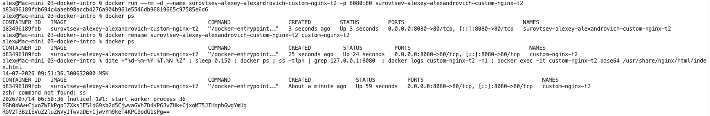

## Задача 3

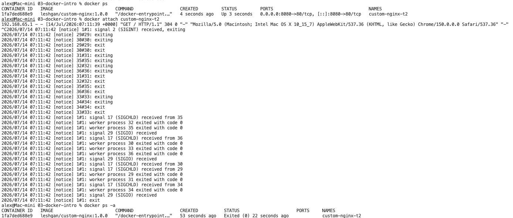

По заданию надо было запустить остановленный контейнер, в скриншоте команда `docker run...`, т.к. чистил контейнеры, пересоздавал. Чтобы не переделывать скриншот пишу текстом, что запуск должен был быть произведен командой `docker start custom-nginx-t2`:

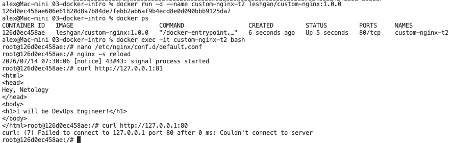

Вышли из контейнера, он запущен, но порт 8080 недоступен, т.к. внутри контейнера мы поменяли конфиг nginx на 81 порт, а контейнер запущен командой слушать порт 8080 и направлять на порт 80, который уже недоступен.

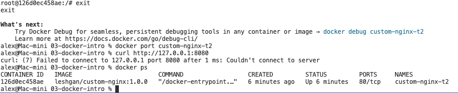

Удаление запущенного контейнера

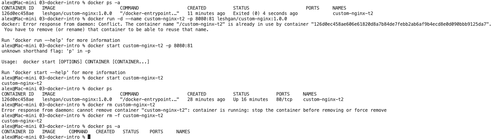

## Задача 4

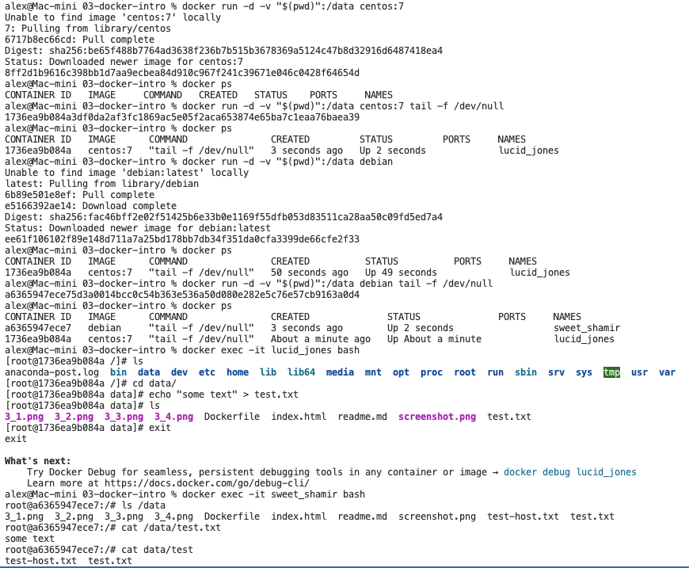

## Задача 5

1. compose.yaml. Потому что это имя файла используется по умолчанию, а так же compose.yml. docker-compose.yaml(yml) поддерживается для обратной совместимости. Если есть оба файла, предпочтение отдаётся compose.yaml
2. 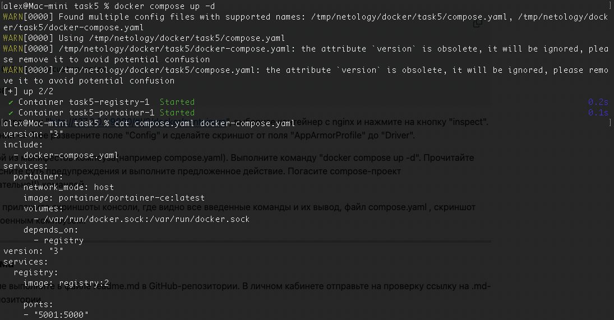
3. 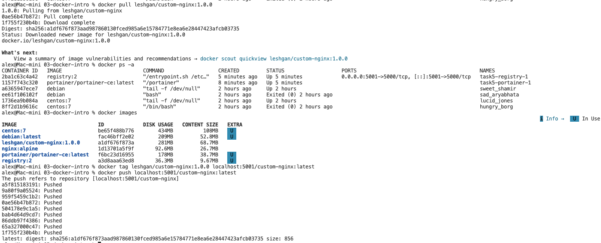
4. push в локальный репозиторий сработал без ошибок в п.3
5. \+
6.

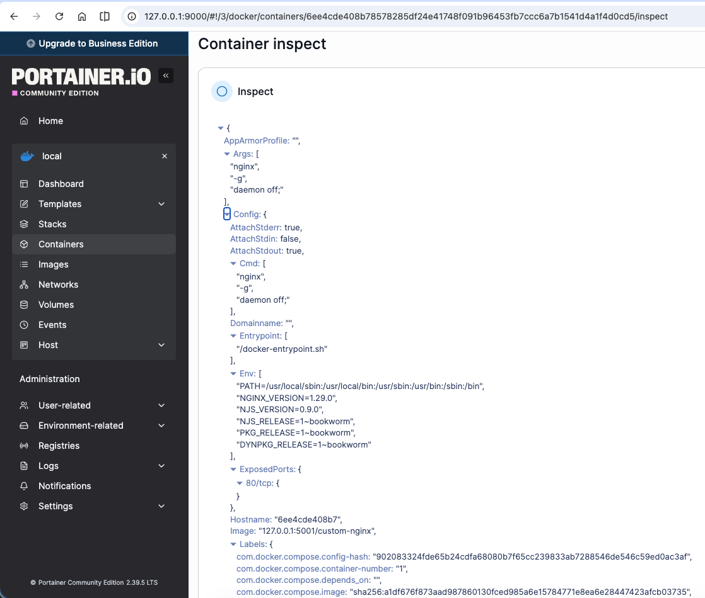

7.  Ошибка говорит о том, что найдет контейнер, для которого удален конфиг (compose файл). Предлагается команда для удаления таких контейнеров.

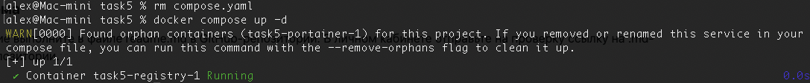
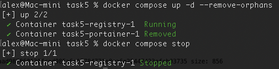
