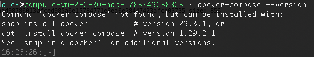
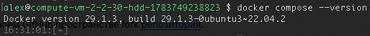
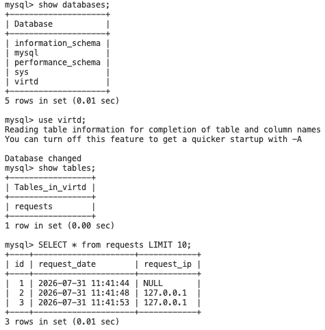
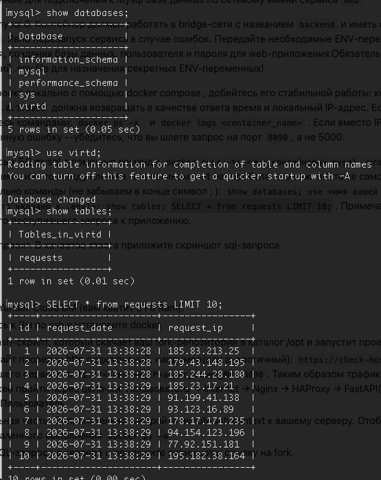
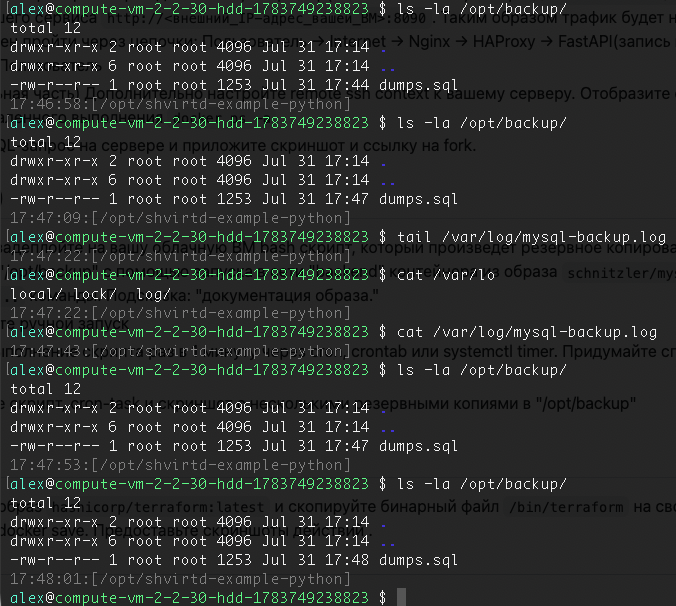
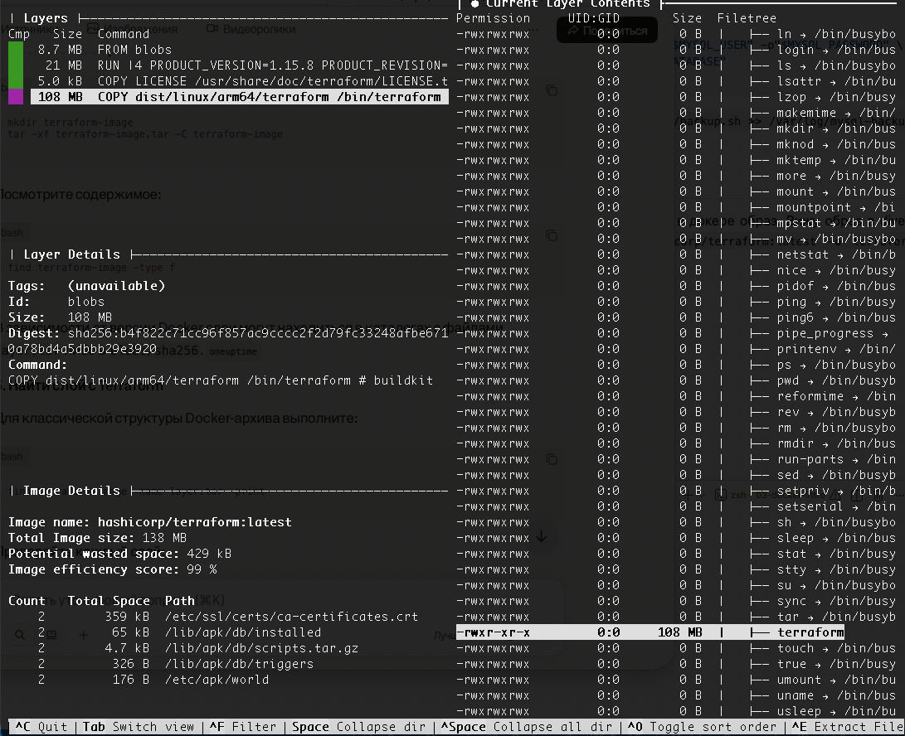
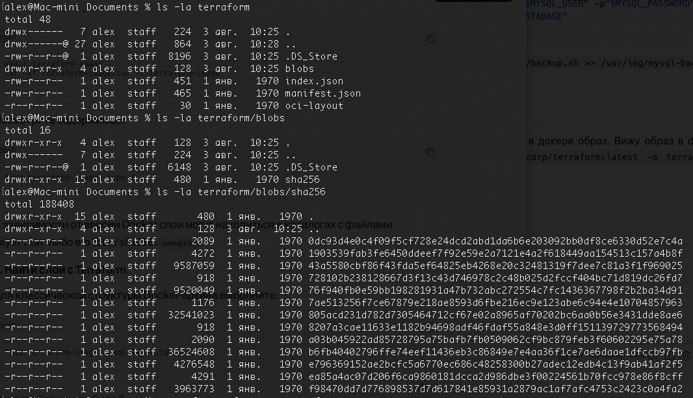

## Задача 0




## Задача 1

https://github.com/Leshgan/shvirtd-example-python

## Задача 2

[Отчет сканирования](vulnerabilities.csv)

## Задача 3



## Задача 4


https://github.com/Leshgan/shvirtd-example-python

## Задача 5



backup.sh

```bash

#!/bin/bash

set -a
source /opt/shvirtd-example-python/.env
set +a

mkdir -p /opt/backup

docker run --rm --entrypoint "" \
  -v /opt/backup:/backup \
  --network shvirtd-example-python_backend \
  schnitzler/mysqldump \
  mysqldump --opt --no-tablespaces -h db -u "$MYSQL_USER" -p"$MYSQL_PASSWORD" \
  "--result-file=/backup/dumps.sql" "$MYSQL_DATABASE"

```

cron task
`* * * * * /opt/shvirtd-example-python/backup.sh >> /var/log/mysql-backup.log 2>&1`

## Задача 6

Не получается. Установил dive локально. Скачал в докере образ. Вижу образ в dive, вижу хэш слоя.

Сохраняю архив `docker save hashicorp/terraform:latest -o terraform.tar`
Распаковал, в нём в папке blobs/sha256 нет такого же хэша, который видел в dive.

Далее только с помощью нейронок получилось извлечь, но я не понял что делаю, если следовать командам нейронок
