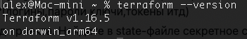
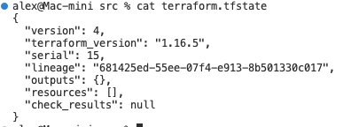
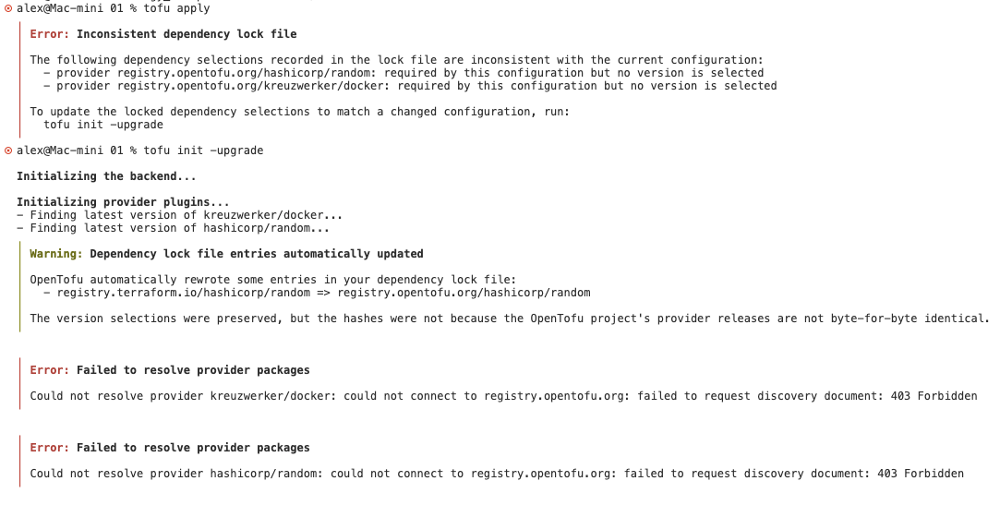

## Задание 1

1. ✅
2. personal.auto.tfvars
3. `"result": "QFeVomc3aQyDCaN5"`
4. 3 ошибки.
   - Отсутствует имя ресурса "docker_image" - после этой строки надо задать имя (лэйбл) ресурса.
   - Неверный формат имени ресурса "docker_container" - "1nginx". Имя не должно начинаться с цифры.
   - Неверное обращение к содержимому ресурса random\*password: `name = "example_${random_password.random_string_FAKE.resulT}"`. Надо `example_${random_password.random_string.result}"`
5. Исправленный код:

```hcl
resource "docker_image" "nginx" {
  name         = "nginx:latest"
  keep_locally = true
}

resource "docker_container" "nginx1" {
  image = docker_image.nginx.image_id
  name  = "example_${random_password.random_string.result}"

  ports {
    internal = 80
    external = 9090
  }
}
```


6. Команда -auto-approve опасна тем, что изменения применяются без ручного подтверждения: могут быть удалены ресурсы или инфраструктура, а разрушительные действия пройдут незаметно.
   Полезна эта команда прежде всего в CI/CD — в пайплайне нет интерактивного ввода, поэтому применение должно идти автоматически. Для локальных экспериментов и отладки безопаснее использовать `terraform plan` и подтверждать применение вручную.

   

7.



8. В коде указано оставлять локально образ:

```
resource "docker_image" "hello_world" {
  name         = "nginx:latest"
  keep_locally = true
}
```

`keep_locally = true`

Из документации:

> keep_locally (Boolean) If true, then the Docker image won't be deleted on destroy operation. If this is false, it will delete the image from the docker local storage on destroy operation.

## Задание 2

[код](main.tf)

```hcl
terraform {
  required_providers {
    docker = {
      source = "kreuzwerker/docker"
    }
  }
  required_version = "~>1.16.0"
}

provider "docker" {
  host = "ssh://alex@178.154.249.190:22"
}

resource "random_password" "random_string" {
  length      = 16
  special     = false
  min_upper   = 1
  min_lower   = 1
  min_numeric = 1
}

resource "random_password" "random_string2" {
  length      = 16
  special     = false
  min_upper   = 1
  min_lower   = 1
  min_numeric = 1
}

resource "docker_image" "mysql" {
  name         = "mysql:8"
  keep_locally = true
}

resource "docker_container" "mysql" {
  image = docker_image.mysql.image_id
  name  = "example_mysql"

  env = [
    "MYSQL_ROOT_PASSWORD=${random_password.random_string.result}",
    "MYSQL_DATABASE=wordpress",
    "MYSQL_USER=wordpress",
    "MYSQL_PASSWORD=${random_password.random_string2.result}",
    "MYSQL_ROOT_HOST=%",
  ]

  ports {
    internal = 3306
    external = 3306
    ip       = "127.0.0.1"
  }
}
```

env переменные на удалённой vm:


## Задание 3

Не очень понял что должно быть в результате этого задания. Получил ошибки, возможно так и должно быть.
А может быть это результат блокировок opentofu в РФ?


