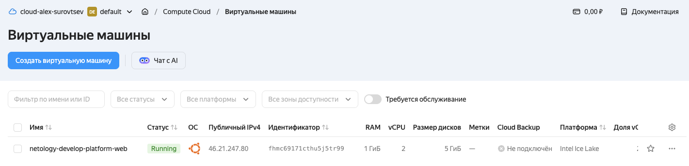
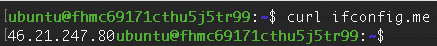
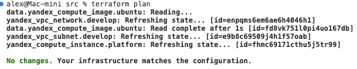

## Задание 1





В [main.tf](./main.tf) были допущены синтаксические ошибки:

- platform_id не может быть со значением standart-v4. Тут и слово standard неверно, так же нет v4.
- core_fraction не может быть со значением 5. В ошибке были перечислены возможные значения.
- для standard-v3 не может cores = 1, о чём так же было объяснено в ошибке.

## Задание 2

Код в [main.tf](./main.tf) и [variables.tf](./variables.tf)



## Задание 3

Код в [main.tf](./main.tf), [variables.tf](./variables.tf), [vms_platform.tf](./vms_platform.tf)
При запуске есть ошибка недоступности зоны ru-central1-b. Насколько я понял, это связано с трудностями у яндекса.

## Задание 4

[output.tf](./output.tf)

Вывод команды `terraform output`:

```
vm_info = {
  "web" = {
    "external_ip" = ""
    "fqdn" = "fhmc69171cthu5j5tr99.auto.internal"
    "instance_name" = "netology-develop-platform-web"
  }
}
```

Если я правильно понимаю, то значения для инстанса db не отображаются, т.к. не создается ВМ в зоне ru-central1-b ([Задание 3](#задание-3))

## Задание 5

в variables.tf добавлены переменные:

```
variable "project" {
  type    = string
  default = "netology"
}

variable "env" {
  type    = string
  default = "develop"
}
```

Файл locals.tf

```
locals {
  vm_web_name = "${var.project}-${var.env}-platform-web"
  vm_db_name  = "${var.project}-${var.env}-platform-db"
}

```

в main.tf используются локальные переменные:

```
resource "yandex_compute_instance" "platform" {
  name        = local.vm_web_name
  platform_id = var.vm_web_platform_id
  resources {
    cores         = var.vm_web_resources.cores
    memory        = var.vm_web_resources.memory
    core_fraction = var.vm_web_resources.core_fraction
  }
  boot_disk {
    initialize_params {
      image_id = data.yandex_compute_image.ubuntu.image_id
    }
  }
  scheduling_policy {
    preemptible = true
  }
  network_interface {
    subnet_id = yandex_vpc_subnet.develop.id
    nat       = true
  }

  metadata = {
    serial-port-enable = 1
    ssh-keys           = "ubuntu:${var.vms_ssh_root_key}"
  }
}

resource "yandex_compute_instance" "platform-db" {
  name        = local.vm_db_name
  platform_id = var.vm_db_platform_id
  zone        = var.zone_b
  resources {
    cores         = var.vm_db_resources.cores
    memory        = var.vm_db_resources.memory
    core_fraction = var.vm_db_resources.core_fraction
  }
  boot_disk {
    initialize_params {
      image_id = data.yandex_compute_image.ubuntu.image_id
    }
  }
  scheduling_policy {
    preemptible = true
  }
  network_interface {
    subnet_id = yandex_vpc_subnet.develop_b.id
    nat       = true
  }

  metadata = {
    serial-port-enable = 1
    ssh-keys           = "ubuntu:${var.vms_ssh_root_key}"
  }

}
```

## Задание 6

1.

```
variable "vms_resources" {
  type = map(string)
  default = {
    web = {
      cores         = 2
      memory        = 1
      core_fraction = 20
    },
    db = {
      cores         = 2
      memory        = 2
      core_fraction = 20
    }
  }
  description = "VM resources"
}
```

2.

```
locals {
  vm_metadata = {
    serial-port-enable = 1
    ssh-keys           = "ubuntu:${var.vms_ssh_root_key}"
  }
}
```

3. Закомментированы неиспользуемые переменные в variables.tf

```
###cloud vars

variable "project" {
  type    = string
  default = "netology"
}

variable "env" {
  type    = string
  default = "develop"
}

variable "cloud_id" {
  type        = string
  description = "https://cloud.yandex.ru/docs/resource-manager/operations/cloud/get-id"
}

variable "folder_id" {
  type        = string
  description = "https://cloud.yandex.ru/docs/resource-manager/operations/folder/get-id"
}

variable "default_zone" {
  type        = string
  default     = "ru-central1-a"
  description = "https://cloud.yandex.ru/docs/overview/concepts/geo-scope"
}
variable "zone_b" {
  type        = string
  default     = "ru-central1-b"
  description = "https://cloud.yandex.ru/docs/overview/concepts/geo-scope"
}
variable "default_cidr" {
  type        = list(string)
  default     = ["10.0.1.0/24"]
  description = "https://cloud.yandex.ru/docs/vpc/operations/subnet-create"
}
variable "cidr_b" {
  type        = list(string)
  default     = ["10.0.2.0/24"]
  description = "https://cloud.yandex.ru/docs/vpc/operations/subnet-create"
}

variable "vpc_name" {
  type        = string
  default     = "develop"
  description = "VPC network & subnet name"
}

# variable "vm_web_name" {
#   type        = string
#   default     = "netology-develop-platform-web"
#   description = "VM name"
# }

variable "vm_web_platform_id" {
  type        = string
  default     = "standard-v3"
  description = "VM platform id"
}

# variable "vm_web_resources" {
#   type = map(string)
#   default = {
#     cores         = 2
#     memory        = 1
#     core_fraction = 20
#   }
#   description = "VM resources"
# }


variable "vm_web_family" {
  type        = string
  default     = "ubuntu-2004-lts"
  description = "VM family"
}

variable "vms_resources" {
  type = map(map(string))
  default = {
    web = {
      cores         = 2
      memory        = 1
      core_fraction = 20
    },
    db = {
      cores         = 2
      memory        = 2
      core_fraction = 20
    }
  }
  description = "VM resources"
}

###ssh vars

variable "vms_ssh_root_key" {
  type        = string
  default     = "<your_ssh_ed25519_key>"
  description = "ssh-keygen -t ed25519"
}

```

В vms_platform.tf:

```
# variable "vm_db_name" {
#   type        = string
#   default     = "netology-develop-platform-db"
#   description = "VM name"
# }

variable "vm_db_platform_id" {
  type        = string
  default     = "standard-v3"
  description = "VM platform id"
}

# variable "vm_db_resources" {
#   type = map(string)
#   default = {
#     cores         = 2
#     memory        = 2
#     core_fraction = 20
#   }
#   description = "VM resources"
# }


# variable "vm_db_family" {
#   type        = string
#   default     = "ubuntu-2004-lts"
#   description = "VM family"
# }

```
